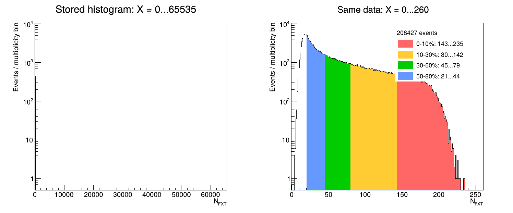
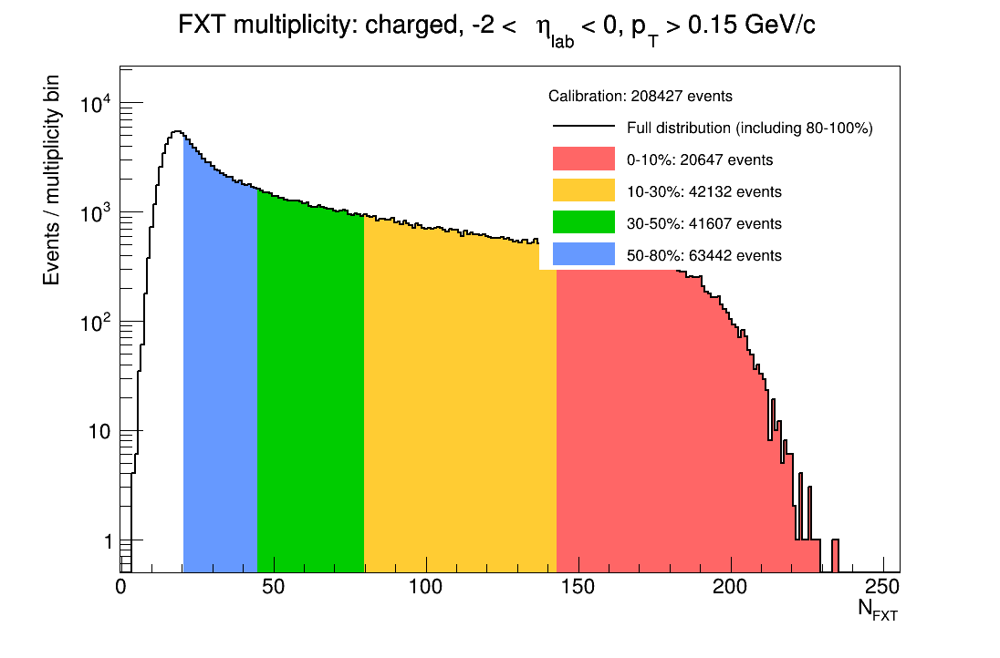

# Проверка FXT-файла на ubuntu-20012202

Проверен файл
`/home/ubuntu/Temir/smash/build/data/Converter/fxt_multi.fixed.mcDst.root`
через существующий VS Code Remote Tunnel с входом через GitHub.
Исходный файл открыт только для чтения.

## Почему гистограмма выглядит сжатой

В гистограммах сохранены 65536 бинов с центрами 0…65535. При этом реальная
FXT-множественность лежит в диапазоне **4…235**. При показе всей оси данные
занимают около 0.35% её длины и практически исчезают у левого края.
Это подтверждённая проблема масштаба отображения.



На подходящем масштабе максимум находится при `NFxt = 19`: 5444 события.
Среднее `NFxt = 62.8136`, RMS `48.75`. Справа виден хвост малой статистики:
в нескольких последних заполненных бинах находится по одному событию.

## Согласованность результата

- `LabEvents`, число записей `McDst` и `LabMultiplicity`: **208427**.
- `LabParticles`: **94557648**, `LabUnknownPDG`: **0**.
- В `MergeInputs` записаны **50** входов.
- Интегралы `hNFxt` и `hNFxtReference`: **208427** каждый.
- Все записи `LabMultiplicity.NFxt` сверены с `hNFxt`: расхождений нет.
- В `FxtCentralityMap` **228** строк; повторов `NFxt` нет, сумма `Events` — **208427**.
- Числа событий по классам в таблице событий и гистограммах совпадают.

| Гистограмма | Фактически заполненные значения | Underflow | Overflow |
| --- | --- | --- | --- |
| `hNAll` | 395…656 | 0 | 0 |
| `hNCh` | 158…372 | 0 | 0 |
| `hNFxt`, `hNFxtReference` | 4…235 | 0 | 0 |

| Класс | NFxt | События | Фактическая доля |
| --- | --- | --- | --- |
| 0–10% | 143…235 | 20647 | 9.9061% |
| 10–30% | 80…142 | 42132 | 20.2143% |
| 30–50% | 45…79 | 41607 | 19.9624% |
| 50–80% | 21…44 | 63442 | 30.4385% |
| Остаток 80–100% | 4…20 | 40599 | 19.4788% |

Небольшие отклонения от заданных долей связаны с сохранением одинаковых `NFxt`
в одном классе; используется середина процентильного интервала группы.
Центральные события находятся справа, при больших `NFxt`.

## Как показать результат

Для существующего файла достаточно макроса, автоматически подбирающего видимую ось:

```bash
root -l -b -q 'scripts/plot_fxt.C("fxt_multi.fixed.mcDst.root","fxt_multi_plot")'
```



Рисунок из проверенного файла также сохранён на Ubuntu в
`/tmp/mcdst-file-inspection/fxt_multi.png` и `.pdf`.

В обновлённом мерджере можно задать новый диапазон самих гистограмм:

```bash
make -j4 mcdst_merge
./mcdst_merge --x-max 700 fxt_multi.x700.mcDst.root tmp/
```

Значение 700 покрывает все три множественности этой выборки. Флаг применяется также
к `hNAll` и `hNCh`, поэтому ограничение 250 поместило бы часть их записей в overflow.
Число событий и калибровка центральности при изменении диапазона сохраняются полностью.
Изменение мерджера проверено локально; исходный файл на Ubuntu не перезаписывался.
